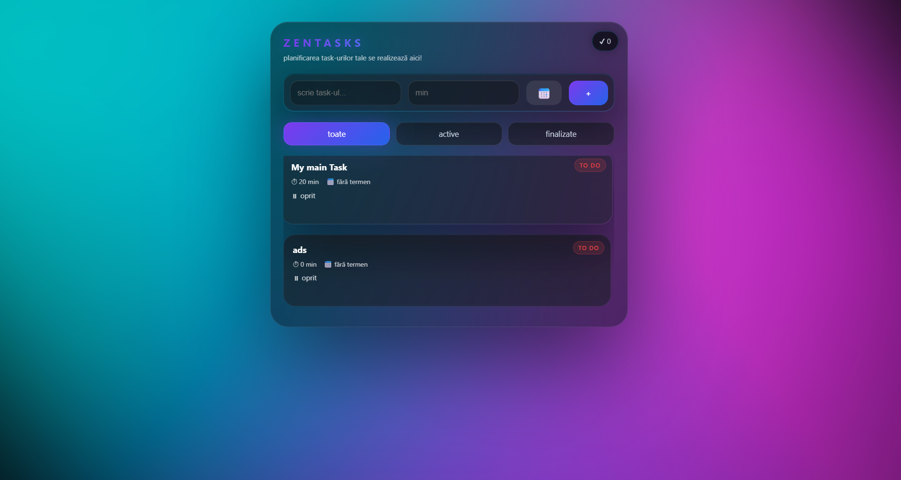
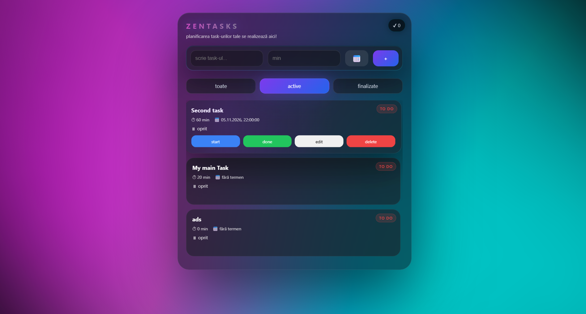
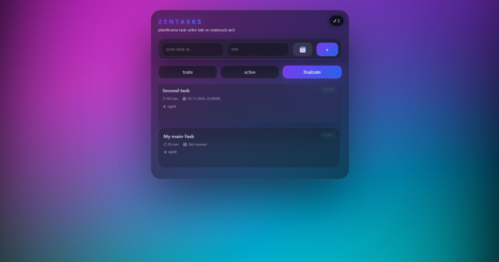
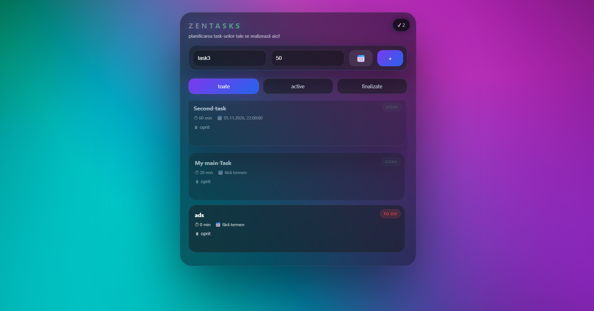

<h1 align="center">ZENTASKS</h1>

<p align="center">
  <strong>A clean, browser-based task manager built with HTML, CSS and vanilla JavaScript.</strong>
  <br />
  Plan tasks, set deadlines, track time and keep your progress saved locally.
</p>

<p align="center">
  
  
  
  
</p>

---

## Overview

**ZENTASKS** is a lightweight task-management application designed to make everyday planning simple and interactive. It lets you create tasks, assign an estimated duration and a deadline, run countdown timers, update or remove entries, and keep track of completed work.

The application is built entirely with **vanilla HTML, CSS and JavaScript**. It runs in the browser, requires no framework or backend, and uses the browser's `localStorage` to preserve task data between visits.

ZENTASKS is designed to handle substantial task lists, including **100+ tasks**. There is no hard-coded task-count limit in the application; practical limits depend on the browser's available local storage and the device.

## Features

- **Create tasks** — add a task by entering its name, with an optional duration in minutes and an optional date and time deadline.
- **Manage your task list** — view tasks in one place, with newly added tasks appearing at the top of the list.
- **Edit tasks** — update a task's name, estimated duration, date or time after creating it.
- **Delete tasks** — remove tasks you no longer need.
- **Track task status** — mark a task as completed manually or let its countdown finish automatically.
- **Countdown timer** — start a task timer based on its estimated duration. The remaining time is displayed while the timer is running.
- **Filter tasks** — switch between **All**, **Active** and **Completed** tasks.
- **Completion counter** — see how many tasks have been completed at a glance.
- **Expandable task cards** — click a task card to expand or collapse it.
- **Toast notifications** — receive visual feedback when tasks are added, updated, completed or deleted.
- **Persistent browser storage** — tasks are saved locally and remain available after closing and reopening the application in the same browser profile.

## Screenshots

The screenshots below show different moments of the application in use.

<p align="center">
  
  
</p>
<p align="center">
  
  
</p>

## Live demo

The repository also includes a screen recording showing the application being used in real time. It walks through the interface and demonstrates the task-management workflow.

**[▶ Watch the ZENTASKS live demo](demos/record.mp4)**

## How it works

### 1. Creating a task

Enter a task name in the text field. You can also provide an estimated duration in minutes and choose a deadline using the calendar control. Press the **+** button to add the task to your list.

A task is stored with its own identifier and properties, including its text, duration, deadline, completion status and timer state.

### 2. Running a countdown

Press **Start** on an active task to begin its countdown. ZENTASKS calculates the remaining time from the task's start timestamp and updates the timer display. When the countdown reaches zero, the task is automatically marked as completed.

You can also use **Done** to complete a task immediately, without waiting for the timer.

### 3. Editing and deleting

Use **Edit** to change the task name, duration or deadline. Use **Delete** to permanently remove the task from the current list and from local storage.

### 4. Filtering and progress

The filter controls let you display all tasks, only active tasks or only completed tasks. The counter in the header shows the **number of completed tasks** and updates when the task list changes.

## Data persistence: JSON + localStorage

One of the key features of ZENTASKS is that the task list is **not lost when the page is refreshed or the browser is restarted**.

The application uses the browser's built-in `localStorage` API and stores the task array as JSON:

- On startup, JavaScript reads the saved value and parses it with `JSON.parse()`.
- Whenever the task list changes, the application converts the array to a JSON string with `JSON.stringify()` and saves it under the `neo_tasks` key.
- On the next visit, the saved JSON is loaded back into JavaScript and the interface is rendered from that data.

This approach provides persistence without a database, server or user account. **The data is local to the browser profile and origin**: it is not automatically synchronized across devices or browsers. Clearing the browser's site data can remove the saved tasks, so this is not a cloud backup.

## Tech stack

| Technology | Role in the project |
| --- | --- |
| **HTML5** | Page structure, task input controls, filters and application layout. |
| **CSS3** | Visual presentation, layout and task-state styling. |
| **Vanilla JavaScript (ES6+)** | Task creation and rendering, event handling, filtering, editing, deletion, countdown logic and persistence. |
| **Web Storage API (`localStorage`)** | Saving and restoring the task list in the browser. |
| **JSON** | Serializing task data for storage and parsing it when the application loads. |

No frameworks, external JavaScript libraries, package manager or build step are required.

## Project structure

```text
ZENTASKS/
├── README.md
├── index.html        # Main application page and UI structure
├── style.css         # Application styling
├── app.js            # Task logic, timers, filters and local storage
└── demos/
    ├── demo1.png     # Application screenshot 1
    ├── demo2.png     # Application screenshot 2
    ├── demo3.png     # Application screenshot 3
    ├── demo4.png     # Application screenshot 4
    └── record.mp4    # Live screen recording
```

## Implementation notes

- The application is a **single-page, client-side project**. There is no server-side component or remote database.
- Task information is stored in the `neo_tasks` local-storage entry as a JSON array.
- The task countdown uses timestamps and `requestAnimationFrame()` to refresh the displayed remaining time.
- The current implementation saves the timer's running state and start timestamp, but it does **not automatically restart an in-progress countdown after a page reload**. The task data itself remains saved; a running timer needs to be started again after reopening the page.
- Dates and times are displayed using the browser's Romanian locale (`ro-RO`), matching the original interface.

## Project background

ZENTASKS was **designed and developed independently by me as my final project for Hackademy Web 101**, a course focused on the fundamentals of **HTML, CSS and JavaScript**.

It was the project I submitted to successfully pass the course, bringing together the core front-end skills covered during the program: building a web interface, styling it with CSS, implementing interactive behavior with JavaScript and preserving application data in the browser.

---

<p align="center">
  <strong>ZENTASKS</strong> · Built with HTML, CSS & JavaScript
  <br />
  <sub>Final project — Hackademy Web 101</sub>
</p>